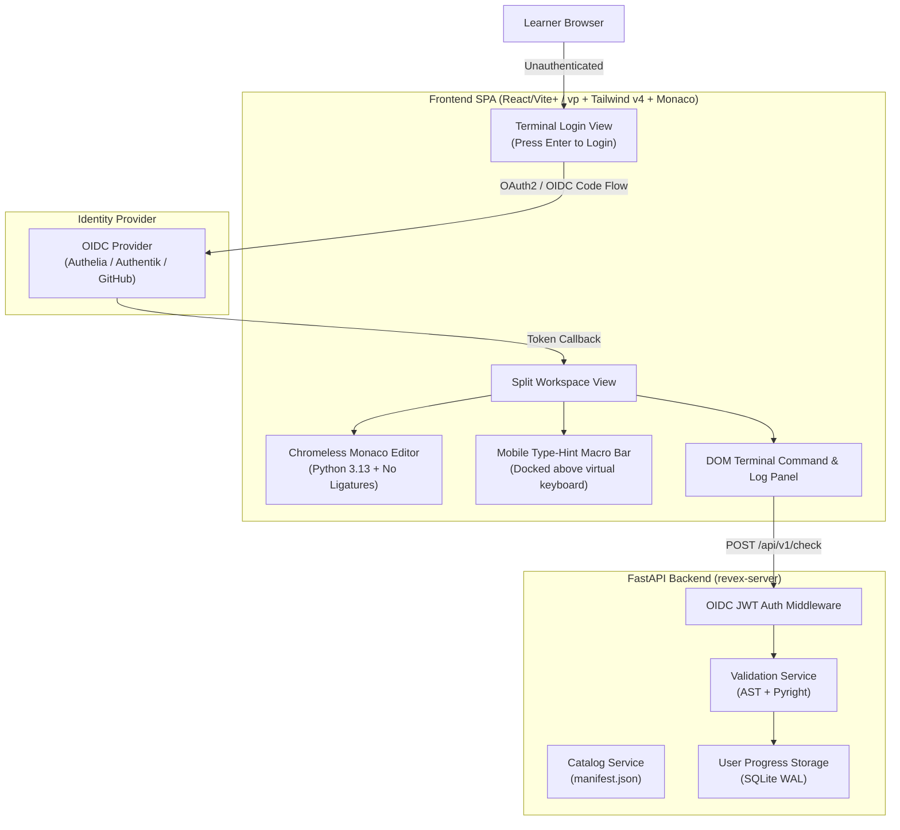

# RFC: Revex Web Playground Architecture

## 1. Overview & Vision

Transform **revex** from a local-only CLI into an interactive, zero-setup web platform while preserving the developer-first terminal aesthetic and the strict AST + Pyright validation engine.

### Point of View: Scientific Monasticism meets Retro-Futuristic UNIX Workstation
- Rejects generic "AI slop" (cliché purple-on-gray gradients, unstyled card grids, and cookie-cutter layouts).
- Evokes the aesthetic discipline of a Bell Labs or DEC VT220 terminal modernized with Swiss typographic precision.
- Distraction-free, high-density, tactile, and engineered around the compiler verification loop.

---

## 2. High-Level Architecture



---

## 3. Visual Tokens & Anti-"Zombie UI" Styling

### 3.1 Color Palette & Textures
- **Base Canvas**: Deep graphite/phosphor charcoal (`#0d1117` / `#101216`).
- **Pane Background**: `#161926` with subtle 1px borders (`rgba(255, 255, 255, 0.08)`).
- **Amber Phosphor (Prompt & AST Hints)**: `#ffb000` / `#e5c07b`.
- **Mint Phosphor (Passing Checks & Streak)**: `#10b981` / `#4ade80`.
- **Vermillion (Pyright Static Errors)**: `#ef4444` / `#f87171`.
- **Tactile Details**: Inset shadow on the terminal panel to emulate a sunken CRT screen; subtle CRT scanline background texture.

### 3.2 Typography with Character
- **Display & UI Chrome**: **Space Grotesk** or **Geist** (high-density, geometric, engineering-first UI headers, tabs, and status badges).
- **Code & Terminal Output**: **JetBrains Mono** or **Commit Mono** with tabular numerals (`font-variant-numeric: tabular-nums`).
- **No Optical Merges**: **Disable default programming ligatures** (`font-variant-ligatures: none`). In Python type hints, learners must clearly see the distinction between `-` followed by `>` (`->`) rather than confusing merged glyphs.

---

## 4. The 5 States Design (Resilient UX)

```
[ State Transition Matrix ]
┌──────────────┐    Select    ┌──────────────┐   Cmd+Enter   ┌──────────────┐
│ 1. Empty     │ ───────────> │ 2. Loading   │ ────────────> │ 3. Error     │ (AST/Pyright fail)
│ (Intro/Zero) │              │ (AST/Pyright)│               └──────────────┘
└──────────────┘              └──────────────┘                      │
                                     │ All pass                     ▼
                                     ▼                       ┌──────────────┐
                              ┌──────────────┐               │ 4. Partial   │ (AST OK, Pyright fail)
                              │ 5. Success   │ <──────────── └──────────────┘
                              │ (Unlocked/🔥)│
                              └──────────────┘
```

1. **Empty State**: Welcoming ASCII prompt: `Type 'revex view next' or select an exercise`. Primary CTA: `[Start Exercise 0101: Basic Type Hints (Space)]`.
2. **Loading State**: Non-blocking phosphor progress line pulsing at the top edge. Terminal streams:
   ```text
   $ revex check workspace/0501-pep695_generics.py
   [..] Analyzing AST structure...
   [..] Invoking Pyright static type checker...
   ```
3. **Error State**: 
   - AST errors highlight missing annotations with amber squiggly lines.
   - Pyright errors highlight type mismatches in vermillion with clickable line coordinates.
   - Network failure preserves code in `localStorage` immediately.
4. **Partial State**: Distinct two-stage checklist in terminal:
   ```text
   [✓] 1. Structural AST Validation: PASSED (All type hints present)
   [✗] 2. Pyright Type Consistency: FAILED
       Line 13, Col 21: Expression cannot be assigned to declared type
   ```
5. **Success State**: Terminal celebration, streak update, and run button transforms into glowing mint `[Next Exercise (Enter) ->]`.

---

## 5. Mobile & Responsive Ergonomics

### The Quick-Insert "Type Hint Macro Bar"
Typing Python type hints on iOS/Android virtual keyboards is notoriously painful. The web client docks a persistent macro bar directly above the mobile keyboard:

```text
+-------------------------------------------------------------+
| MOBILE ACCESSORY STRIP (Docked right above virtual keyboard)|
| [ : ] [ -> ] [ | ] [ [ ] ] [ int ] [ str ] [ None ] [ ⇥ Tab]|
+-------------------------------------------------------------+
```

- One-tap buttons for high-frequency tokens: ` : `, ` -> `, ` | `, ` [ ] `, `int`, `str`, `bool`, `float`, `list[`, `dict[`, `Optional[`, `None`, `Tab`.
- Tapping `list[` inserts `list[]` and leaves the cursor nestled inside `[]`.
- **Responsive Layout**:
  - Desktop (`>= 1024px`): 3-column split (Guide 25% | Monaco 45% | Terminal 30%).
  - Tablet (`768px - 1023px`): 2-pane split (Guide + Monaco on top, Terminal drawer on bottom).
  - Mobile (`< 768px`): Single-view with sliding bottom tabs (`[Spec]` | `[Code]` | `[Terminal]`).

---

## 6. Keyboard Shortcuts & Terminal Interaction

- **`Cmd+Enter` / `Ctrl+Enter`**: Run Validation Check.
- **`Cmd+Shift+Enter`**: Check & Auto-Advance if passing.
- **`Cmd+H` / `Ctrl+H`**: Request progressive hint.
- **`Cmd+Option+R`**: Reset exercise to template (`--restore`).
- **`Ctrl+M`**: Toggle Monaco "Tab Moves Focus" mode (WCAG 2.1.2 compliance).
- **`Esc`**: Focus back to Monaco editor.
